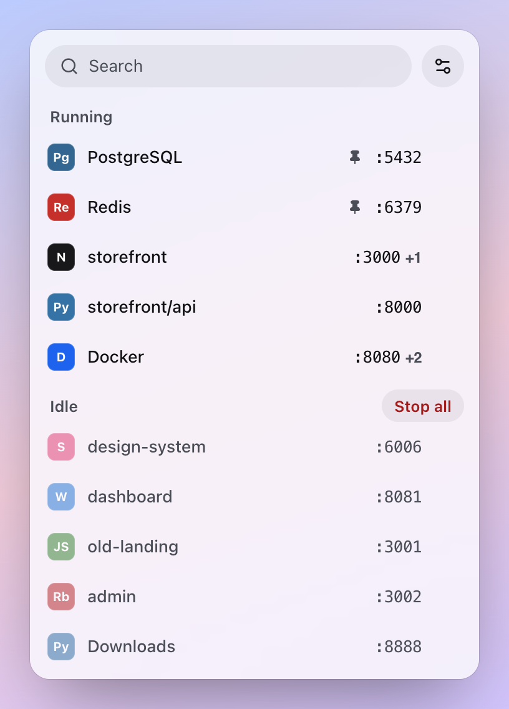
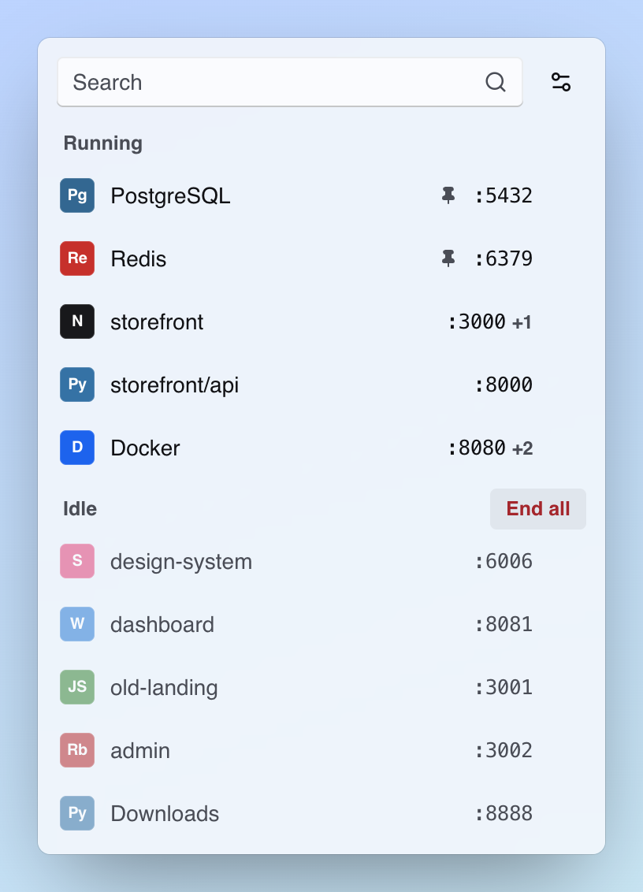
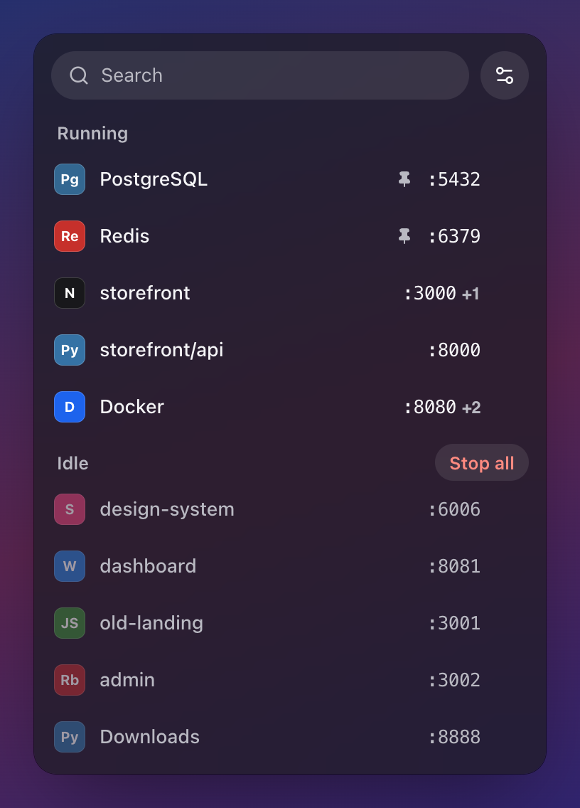
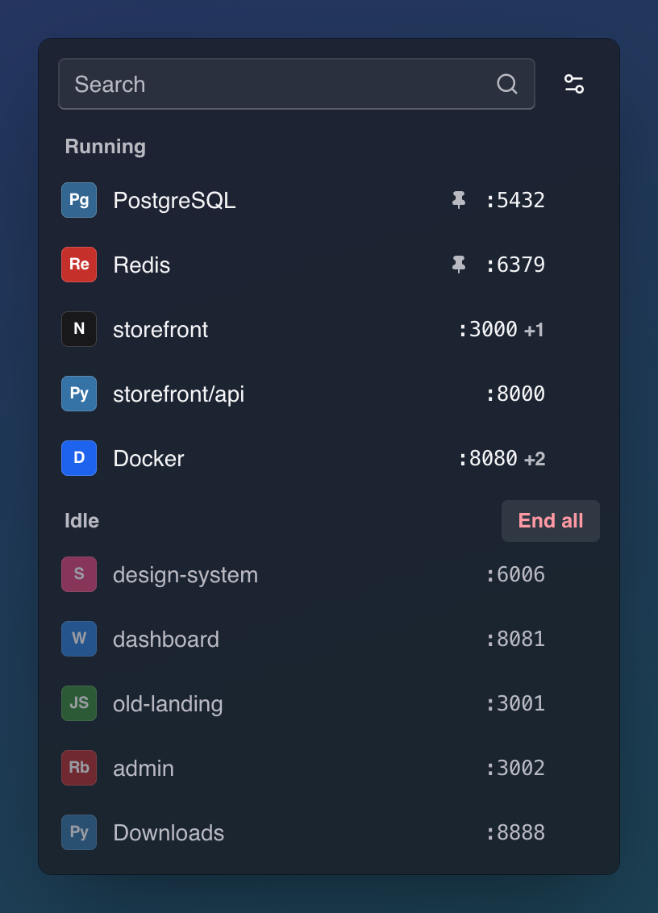

<div align="center">


# PortKiller

See which apps are holding your ports, and stop them safely.<br>
A small, open-source menu bar and tray app for macOS and Windows.

[](https://github.com/edisonaugusthy/PortKiller/actions/workflows/ci.yml)
[](https://github.com/edisonaugusthy/PortKiller/releases/latest)
[](LICENSE)

</div>

| macOS | Windows |
| :---: | :---: |
|  |  |
|  |  |

<sub>Screenshots of the real interface with sample processes (`npm run dev`, then open `/?demo`).</sub>

## Download

| Platform | Download |
| --- | --- |
| Windows 10 and 11 | [PortKiller-Windows-Setup.exe](https://github.com/edisonaugusthy/PortKiller/releases/latest/download/PortKiller-Windows-Setup.exe) |
| macOS 14.5 and later | Coming once the app is signed and notarized. Until then, [build it from source](#build-from-source). |

Both links always point at the newest release. PortKiller updates itself: when a new version is out, the list shows **Update**.

## What it does

- **Every listening app at a glance.** One row per app: its icon, its name (the project folder when there is one, so two Node servers read as `storefront` and `api`) and its port. `+2` means it listens on more ports.
- **Running and Idle.** Apps with no noticeable CPU for 30 minutes (configurable) move to Idle, largest first, with **Stop all** to free them in one go. Pin the ones you never want stopped.
- **One click for details.** Every port with Open and Copy, plus the app, CPU, memory, uptime and folder.
- **Stop with confidence.** Confirmations name every port that will be freed. On macOS, Stop asks the app to quit and Option-click forces it; on Windows, End task ends it.
- **Search anything.** Start typing or press ⌘F / Ctrl+F to filter by port, app, project or PID.
- **Looks native.** Liquid Glass on macOS 26, Acrylic on Windows 11, light and dark, and solid colors when transparency is reduced.
- **Light on resources.** No dock icon and no background timers. The window is created when you open it and destroyed when you close it. About 17 KB of JavaScript.

## Safety

All process inspection and stopping happens in Rust; the interface cannot run commands or touch files. Before every stop PortKiller checks again that the process:

- belongs to you (UID on macOS, Windows user SID),
- is the same process (its start time hasn't changed, so a recycled PID is never hit),
- still listens on exactly the ports you confirmed,
- is not a system process or PortKiller itself.

If anything changed, the stop is refused and you review it again. No `sudo`, admin rights or helper tools are used.

## Privacy

PortKiller has no analytics or telemetry. Its only network request is the update check, which asks GitHub Releases for a newer version at most every six hours while the menu is open. Updates are verified against a signing key built into the app before they are installed.

## Build from source

You need Node.js 22.12+, Rust 1.90+, and either macOS 14.5+ with the Xcode Command Line Tools, or Windows 10/11 with the Visual Studio C++ Build Tools and WebView2 (preinstalled on Windows 11).

```sh
git clone https://github.com/edisonaugusthy/PortKiller.git
cd PortKiller
npm install
npm run tauri dev      # run the app from source
npm run tauri build    # build PortKiller.app or the Windows installer
```

To work on the interface in a browser with sample processes, run `npm run dev` and open `http://127.0.0.1:1420/?demo`. Add `&windows` for the Windows look, `&theme=dark`, `&dense` for a long list, `&empty`, or `&update` to show the update notice. The demo is removed from release builds.

Checks (CI runs the same on macOS and Windows):

```sh
npm run build
cd src-tauri && cargo fmt --check && cargo clippy --all-targets -- -D warnings && cargo test
```

## How it is built

```
src/                     Interface: one TypeScript file, one stylesheet, no framework
src-tauri/src/
  scanner.rs             Shared: grouping, CPU and idle tracking, stop validation
  ports.rs               Tray, window, settings, updates and the commands the interface calls
  platform/macos.rs      lsof, libproc, signals, app icons from macOS
  platform/windows.rs    TCP table, process info, End task
.github/workflows/       CI on macOS and Windows; the manual Release workflow
```

Everything that differs between macOS and Windows sits in `src-tauri/src/platform/` behind the same eight functions, so the rest of the app is shared. Measurements and test notes are in [`docs/verification.md`](docs/verification.md).

## Releasing

1. Set the version in `package.json`, `src-tauri/Cargo.toml` and `src-tauri/tauri.conf.json`, then commit and push.
2. Run **Actions › Release › Run workflow**. It builds the Windows installer, signs the update and publishes the release with `latest.json`, which installed apps use to offer the update.

The workflow needs the `TAURI_SIGNING_PRIVATE_KEY` secret (from `npm run tauri signer generate`). The macOS job is ready in the workflow but commented out until an Apple Developer ID is available.

## Limits

PortKiller shows TCP servers, not outgoing connections or UDP. For containers and virtual machines it manages the host-side proxy process, not services inside the guest. Process managers may restart what you stop.

## Contributing

Bug reports, ideas and pull requests are welcome. Start with [CONTRIBUTING.md](CONTRIBUTING.md); for security issues, follow [SECURITY.md](SECURITY.md) instead of opening a public issue.

## License

[MIT](LICENSE) © Edison Augusthy
